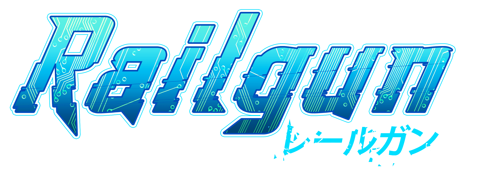

    

---

Railgun-fast paced GraphQL API for Mathrix Education.
Proudly maintained by Mathieu Bour <mathieu@mathrix.fr>, Lead Tech at Edutech Media.

Contributors:
- Valentin Pollart <valentin@mathrix.fr> ;
- Dimitri Bret <dimitri@mathrix.fr>.

## Technologies
This project is mainly based on the [Lumen Framework][lumen], edited by [Laravel][laravel].
Railgun also uses [Lighthouse][lighthouse] GraphQL engine. 

[lumen]: https://lumen.laravel.com
[laravel]: https://laravel.com
[lighthouse]: https://lighthouse-php.com

## Conventions
### GraphQL
As a GraphQL API, Railgun follows the [GraphQL specification](https://spec.graphql.org/June2018/) (latest update: June
2018).

### Code
This repository follows the [Mathrix Coding Standard][code-standard]. The code is linted by
[PHP_CodeSniffer][codesniffer].

[code-standard]: https://github.com/mathrix-education/coding-standard
[codesniffer]: https://github.com/squizlabs/PHP_CodeSniffer

### Commits
This repository follows the [Conventional Commits][conventional-commits] specification. The node package
[standard-commit][standard-commit] may be used to create commits.

[conventional-commits]: https://www.conventionalcommits.org/en/v1.0.0-beta.4
[standard-commit]: https://www.npmjs.com/package/standard-commit
